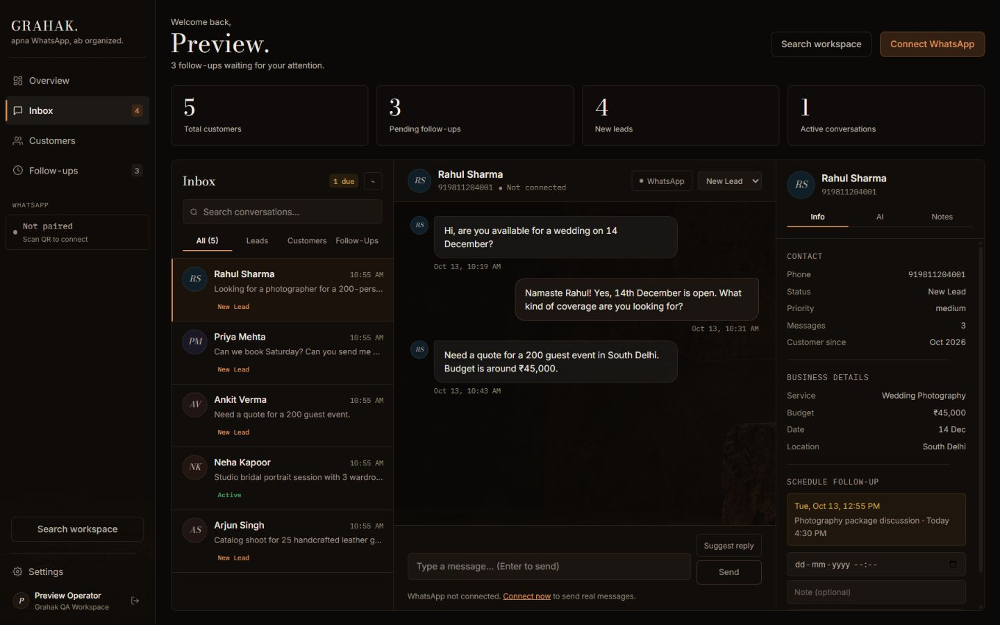
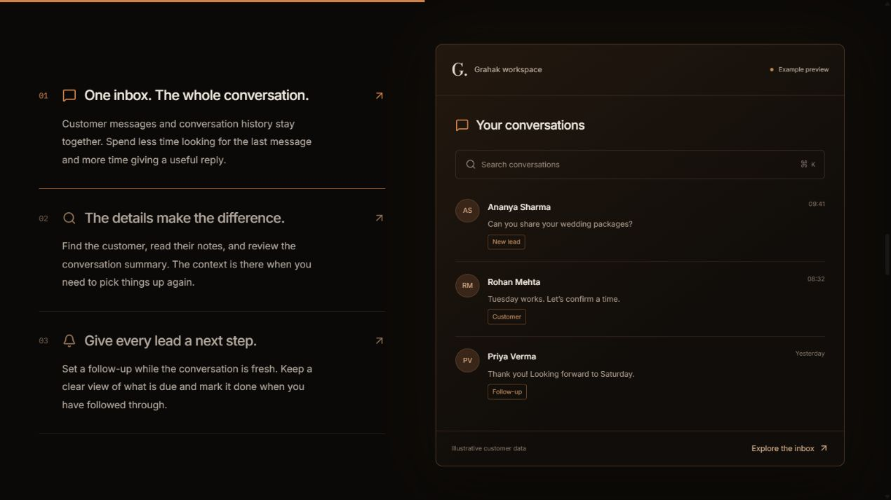
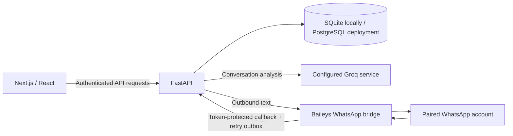

# Grahak — WhatsApp CRM

**A portfolio project by Parardha Dhar.** Grahak brings customer conversations, contact context, AI summaries, and follow-ups into one workspace for small businesses.

**Live early access:** [grahak-flame.vercel.app](https://grahak-flame.vercel.app). Requests open an email draft; visitors send it to submit their request. The full CRM is shown in a separate demo workspace and requires hosted backend/database/bridge services before public account onboarding.

> **Hiring / collaboration:** [parardhadhar@gmail.com](mailto:parardhadhar@gmail.com)
> This repository is a technical showcase. It includes the application and API source; it does not include live credentials, customer data, or a paired WhatsApp account.



## What I built

- A responsive Next.js CRM with a conversation inbox, searchable customer records, notes, tags, and scheduled follow-ups.
- A cinematic marketing site with a supplied hero video, React Motion transitions, interactive product previews, and a scroll-driven workspace story.
- FastAPI routes for authentication, onboarding, contacts, messages, search, reminders, dashboards, and integration management.
- JWT authentication and business-scoped data access, with tests for tenant isolation.
- A Baileys WhatsApp bridge with authenticated callbacks, reconnect handling, duplicate-message protection, and an outbox that survives restarts.
- Groq conversation analysis with bounded timeouts and fallback behavior when the provider is unavailable.



## Architecture



| Layer | Implementation |
| --- | --- |
| Web | Next.js 16, React 19, TypeScript, Tailwind CSS 4 |
| Motion | Framer Motion, scroll-linked transforms, spring transitions |
| API | Python FastAPI, Pydantic, SQLAlchemy async |
| Data | SQLite for local development; PostgreSQL driver support |
| Authentication | JWT, password hashing, business-scoped queries |
| AI | Groq; model configurable through environment variables |
| WhatsApp | Baileys companion bridge; optional Meta Cloud API transport |
| Verification | Pytest, Node test runner, ESLint, Next.js production build |

## Run locally

Requirements: Node.js 22+, Python 3.12, and three terminals. Real WhatsApp and AI require your own account configuration.

### 1. Backend

```powershell
cd backend
python -m venv .venv
.\.venv\Scripts\Activate.ps1
pip install -r requirements.txt
Copy-Item .env.example .env
python -m uvicorn app.main:app --host 127.0.0.1 --port 8000
```

Interactive API docs: **http://localhost:8000/docs**. Create a workspace through the frontend before assigning a WhatsApp bridge.

### 2. Frontend

```powershell
cd frontend
npm ci
Copy-Item .env.example .env.local
npm run dev
```

Open **http://localhost:3000**. For a production build, run `npm run build`, then `npm run start`.

### 3. Optional WhatsApp bridge

```powershell
cd whatsapp-bridge
npm ci
Copy-Item .env.example .env
cd ../backend
python configure_bridge.py
python configure_bridge.py --business-id YOUR_BUSINESS_ID
cd ../whatsapp-bridge
npm start
```

The helper validates the business and configures matching shared credentials in the two local environment files. Restart the backend after configuration. Pair WhatsApp from Settings in the app. One bridge process serves one configured account/workspace.

Configure `GROQ_API_KEY` in the backend environment to enable external analysis. Without a configured key, provider-backed AI is unavailable. The repository does not contain keys.

## API surface

Routes are under `/api/v1`; inspect the running backend's OpenAPI documentation for request and response schemas.

| Area | Route prefix | Purpose |
| --- | --- | --- |
| Authentication | `/auth` | Signup, login, current user |
| Business | `/business` | Profile, onboarding, authenticated WhatsApp management |
| Contacts | `/contacts` | Customer records, message history, notes, follow-ups |
| Dashboard | `/dashboard` | Workspace metrics and recent activity |
| Search | `/search` | Customer and conversation search |
| Reminders | `/reminders` | Due work and completion |
| Webhooks | `/webhook` | Validated integration callbacks |

## Checks

```powershell
cd frontend
npm run lint
npm run build
cd ../backend
python -m pytest tests -q -p no:cacheprovider
cd ../whatsapp-bridge
npm test
npm run check
```

Latest local verification: **23 backend tests passed**, the persistent outbox test passed, frontend lint and production build passed. Browser checks cover desktop/mobile navigation and interactive previews. Backend tests use a separate database and mock external AI.

## Deployment and boundaries

The frontend is prepared for Vercel. Set the project root to `frontend`, configure a public backend URL, and deploy using your own account. A persistent host is required for the backend database and the long-running WhatsApp bridge; deploying only the frontend does not deploy these services.

Before hosting the backend: set `DEV_MODE=false`, a strong `SECRET_KEY`, the deployed `FRONTEND_URL`, and integration settings. Keep database backups and persist the bridge session and retry outbox. See [launch notes](docs/LAUNCH_READINESS.md).

Current composer supports text messages. Media upload, voice recording, billing, multi-account bridge orchestration, and automatic reminder sending are not implemented. Scheduled follow-ups are tasks for the user to complete. Outbound live delivery has not been verified with a user-authorized test recipient.

The proposed starter offering is **up to 10 customer chats**; higher-volume enquiries can contact [parardhadhar@gmail.com](mailto:parardhadhar@gmail.com). This is a showcase proposal, not an enforced billing or quota system.

Product previews use illustrative data. The supplied hero footage and generated artwork illustrate the product; they are not evidence of customer adoption.

## Repository guide

```text
frontend/          Marketing site, auth, onboarding, CRM screens
backend/app/       API, models, integrations, message processing
backend/tests/     Isolated API and tenant tests
whatsapp-bridge/   WhatsApp connection and persistent retry outbox
docs/              Screenshots and deployment notes
```

## Hiring and collaboration

This project demonstrates frontend design and motion, API development, asynchronous integrations, data modeling, and reliability work. For opportunities or a walkthrough, email **[parardhadhar@gmail.com](mailto:parardhadhar@gmail.com)**.
